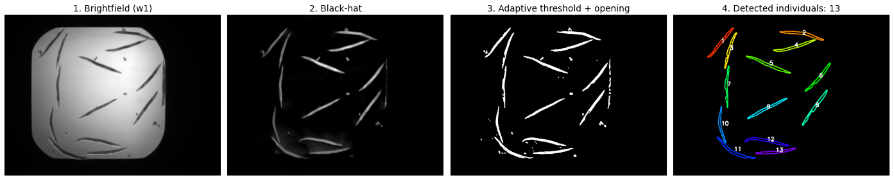
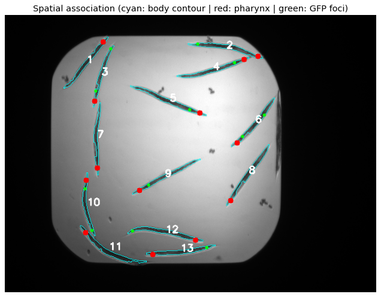

# Automated C. elegans Segmentation and Feature Association: Mapping Gene Expression and Pharynxes

Academic project developed for the Master's in Bioinformatics (UDC). A biomedical imaging and computer vision pipeline designed to segment *Caenorhabditis elegans* individuals and perform **spatial association** of their internal biological structures (pharynxes and `clec-60` GFP expression foci) using multichannel 16-bit TIFF images.

## 1. The Spatial Association Challenge
In multi-organism images, simply detecting features is insufficient; the core challenge is correctly attributing each detected expression focus or pharynx to the exact bodily mask of the corresponding nematode.

This project solves this structural problem through:
- **Independent Normalization:** Min-Max rescaling (to uint8 [0-255]) applied per channel to prevent the brightfield channel from attenuating weaker fluorescent signals.
- **Hierarchical Data Architecture:** Implementation of nested dictionaries to store IDs, contours, masks, and quantitative feature counts.
- **Centroid-in-Mask Logic:** Validating the ownership of an internal structure by checking if its (X, Y) spatial coordinates fall within a region strictly `>0` in an individual's binary mask.

## 2. Dataset Specifications
The images utilized in this pipeline are part of the **Broad Bioimage Benchmark Collection** (image set BBBC012v1). These high-resolution files are not hosted in this repository due to their 16-bit depth and substantial size.

- **Source:** [Broad Bioimage Benchmark Collection (BBBC)](https://bbbc.broadinstitute.org/BBBC012)
- **Download:** [BBBC012_v1_images.zip](https://data.broadinstitute.org/bbbc/BBBC012/BBBC012_v1_images.zip) (117 MB)
- **Quantity:** 8 multichannel images, a subset of BBBC012: wells M08, M11, M12, M16, M19, M24, N04 and N05 of the `pmk1_plate2` folder.
- **Dimensions:** 696 x 520 pixels.
- **Bit Depth:** 16-bit (TIFF format).
- **Dynamic Range:** varies by channel and by image (maximum values: 4095 in brightfield, 1716 in GFP and 1052 in mCherry), so each channel of each image is normalized independently.
- **Channels:**
    - **w1:** Brightfield (Anatomical reference).
    - **w2:** GFP (`clec-60` gene expression).
    - **w3:** mCherry (Pharynx localization).
- **Citation:** Image set BBBC012v1 was used, provided by Javier Irazoqui and available from the Broad Bioimage Benchmark Collection [[Ljosa et al., *Nature Methods*, 2012](https://doi.org/10.1038/nmeth.2083)].

## 3. Processing Methodology
The workflow applies specific computer vision strategies tailored to each channel's characteristics:

- **Anatomical Segmentation (w1 - Brightfield):** To mitigate uneven background illumination, a median filter is applied, followed by a **Black-Hat** morphological transformation (61x61 elliptical kernel) to extract dark structures. Individuals are isolated using Adaptive Gaussian Thresholding and cleaned via a Morphological Opening (3x3 kernel). Artifacts are removed using an area filter (>300 pixels).

- **Gene Expression (w2 - GFP):** Operating on a dark, uniform background, a global binary threshold (Threshold = 48) is applied to discriminate true expression foci from the amplified basal autofluorescence of the nematode's body.

- **Pharynx Localization (w3 - mCherry):** A global threshold (Threshold = 40) is combined with a targeted morphological dilation (4x4 circular kernel, 2 iterations). This is designed to fuse the two pharyngeal lobes into a single quantifiable mass.



*Segmentation of the brightfield channel (w1) for one of the 8 images.*

## 4. Results and Model Limitations
Once the parameters are set, the pipeline runs without manual intervention and generates a detailed 1:N mapping per individual, identifying **0 to 6 GFP expression foci per individual** (with the majority between 0 and 3).



*Final association for the same image: each of the 13 detected individuals is assigned its pharynx (red) and its GFP expression foci (green).*

**Deviation Analysis:**
- Association accuracy is highly dependent on successful individual separation in the w1 channel. Nematodes in extreme proximity are occasionally segmented as a single continuous object.
- The dilation operation in the w3 channel presents a biological trade-off: while it successfully fuses individual lobes, in high-density areas it may cause the accidental fusion of pharynxes from adjacent nematodes. This shifts the resulting centroid outside the boundaries of either bodily mask, preventing proper association.

**Limitations:** the thresholds and kernel sizes were tuned by hand on these 8 images, and the results were validated visually, not against a manual annotation. They should be checked on new images before being used for other experiments.

## 5. Environment Requirements and Execution
Developed with Python 3.11. Install the required dependencies to replicate the environment and ensure proper reading of 16-bit `.tif` files:

```bash
pip install -r requirements.txt
```

Then:
1. Download [BBBC012_v1_images.zip](https://data.broadinstitute.org/bbbc/BBBC012/BBBC012_v1_images.zip) and, from its `pmk1_plate2` folder, copy the 24 `.tif` files of wells M08, M11, M12, M16, M19, M24, N04 and N05 (3 channels each) into a folder named `dataset/`, next to the notebook.
2. Open `celegans_feature_association.ipynb` (with Jupyter, or directly in VS Code) and run all cells in order.

```bash
pip install notebook   # only if Jupyter is not installed
jupyter notebook celegans_feature_association.ipynb
```
